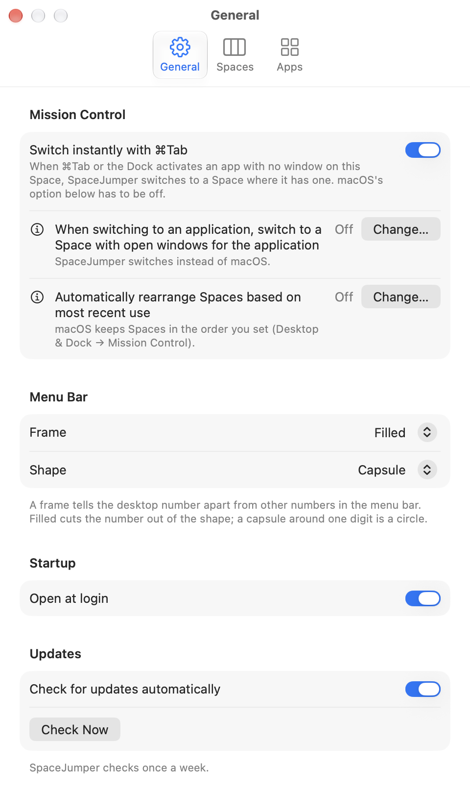
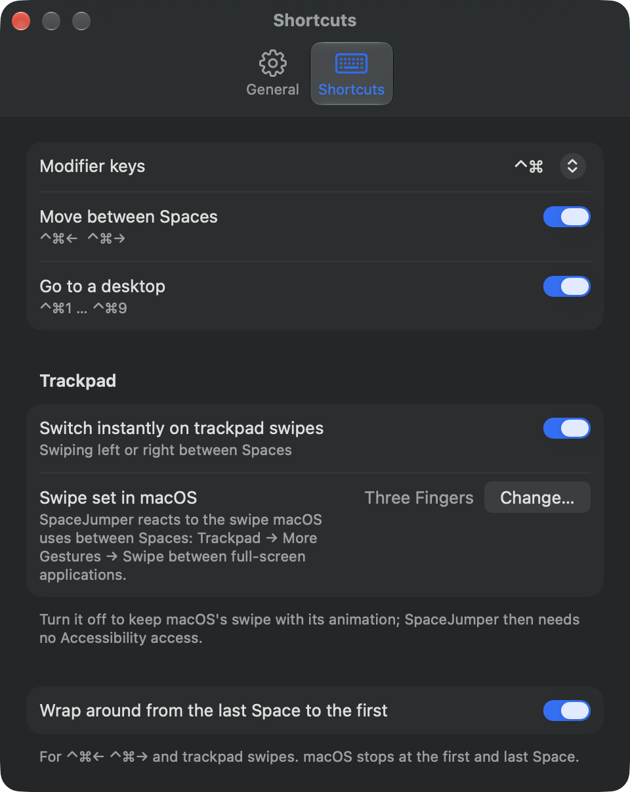

# SpaceJumper

[](https://github.com/alberti42/SpaceJumper/actions/workflows/verify-release.yml)
[](https://github.com/alberti42/SpaceJumper/actions/workflows/build.yml)

**A menu-bar app for macOS that switches between Spaces without the slide animation, or with a slide as long as you choose.**

Ever wished you could jump between your Mac's Spaces like a Star Wars starship
making the jump to lightspeed? SpaceJumper switches Spaces instantly, without macOS's slide. And
if you'd like to see the jump, you can set how long it takes.

**[Download SpaceJumper.zip](https://github.com/alberti42/SpaceJumper/releases/latest/download/SpaceJumper.zip)** (latest release, signed and notarized). See [Installation](#installation).

Free and open source (GPL-3.0). Requires macOS 26 or later; runs natively on
Apple silicon and Intel Macs. Works with System Integrity Protection (SIP)
enabled, as it is on every Mac by default: you do not need to turn it off.

macOS has no setting to turn off the animation that plays when you switch
Spaces. "Reduce motion" replaces the slide with a cross-fade, which is still an
animation. SpaceJumper switches with no animation at all: the new Space
appears at once. If you prefer a slide, SpaceJumper draws its own, as long as
you set it.

<p align="left">
  
  
</p>

---

## Table of Contents

- [Features](#features)
- [Status](#status)
- [Installation](#installation)
- [Permissions and privacy](#permissions-and-privacy)
- [Troubleshooting](#troubleshooting)
- [How it works](#how-it-works)
- [Building from source](#building-from-source)
- [Related projects](#related-projects)
- [Credits](#credits)
- [License](#license)

---

## Features

- **Keyboard shortcuts**: the modifier keys you choose in Settings, followed by
  ← or → to move one Space, or by 1 … 9 to go to that desktop. The modifier
  keys are ⌃ (the default, as in macOS's own Mission Control shortcuts), ⌃⌥,
  ⌃⌘, ⌥⌘ or ⌃⌥⌘, the same for both groups. Either group can be switched off.
- **Trackpad swipes** between Spaces switch instantly too (on by default; can be
  switched off in Settings). This needs Accessibility access; see
  [Permissions and privacy](#permissions-and-privacy).
- **⌘Tab** (off by default): when ⌘Tab or the Dock activates an app with no
  window on the current Space, SpaceJumper switches to the Space of its
  frontmost window, instantly or with your slide. Turn it on in Settings →
  General; a button there turns off macOS's own switch, which would slide.
- **Menu-bar item** showing the number of the current desktop, or "F" on a
  full-screen Space. It can have a frame, to tell it apart from other numbers
  in the menu bar: an outline or a filled shape with the number cut out, as a
  rounded rectangle or a capsule.
- **Settings window** (Settings… in the menu, ⌘,), shown
  [above](#spacejumper). Besides the options in this list, it lists the
  shortcuts that macOS or another app already uses with the same keys, and
  shows the macOS settings that affect SpaceJumper: how swiping between Spaces
  is set in Trackpad settings, whether macOS switches Spaces when an app is
  activated, and whether macOS rearranges Spaces by recent use.
- **Desktop numbers** count desktops as Mission Control names them ("Desktop
  1", "Desktop 2", …); full-screen Spaces are skipped. ⌃← and ⌃→ include
  full-screen Spaces and stop at the first and last Space, as macOS does
  without SpaceJumper.
- **Slide animation** (off by default): a slide of your chosen length, 0 to
  500 ms in 10 ms steps, for the shortcuts and swipes. SpaceJumper draws it
  itself, so ⌃1 … ⌃9 slide straight to the desktop.
- **Wrap around** (off by default): ⌃← ⌃→ and trackpad swipes go from the last
  Space to the first and back.
- **Several displays**: the shortcuts act on the display with the active menu bar.
- **Open at login**, through a login helper registered with macOS.
- **Updates** through [Sparkle](https://sparkle-project.org): SpaceJumper
  checks for a new version once a week, or when you choose Check for Updates in
  its menu.
- **Works with System Integrity Protection (SIP) enabled**, as it is on every
  Mac by default: you do not need to turn it off. SpaceJumper loads no code
  into other processes.

## Status

SpaceJumper relies on private macOS interfaces (see
[How it works](#how-it-works)), which Apple can change in any update.

Tested on one Mac with macOS 27.0.1.

Not yet tested:

- macOS 26. SpaceJumper declares macOS 26 as its minimum, but no one has run
  it there yet. If you find a problem on macOS 26, please open an
  [issue](https://github.com/alberti42/SpaceJumper/issues).
- More than one display.

## Installation

1. Download [`SpaceJumper.zip`](https://github.com/alberti42/SpaceJumper/releases/latest/download/SpaceJumper.zip)
   from the [latest release](https://github.com/alberti42/SpaceJumper/releases/latest).
2. Unzip it and move `SpaceJumper.app` to the Applications folder.
3. Open it. The number of the current desktop appears in the menu bar.
4. macOS asks whether SpaceJumper may use Accessibility. Allow it for instant
   trackpad swipes (System Settings → Privacy & Security → Accessibility); the
   keyboard shortcuts work without it. See
   [Permissions and privacy](#permissions-and-privacy).
5. If macOS's own shortcuts use the same keys, Settings → Shortcuts lists them
   under Conflicts, with a button that opens Keyboard Shortcuts, where you
   turn them off.
6. To start SpaceJumper when you log in, turn on Open at Login in its Settings.

The app is signed with a Developer ID and notarized by Apple. To check where a
downloaded ZIP was built:

```sh
gh attestation verify SpaceJumper.zip --repo alberti42/SpaceJumper
```

To report a security problem privately, see [SECURITY.md](SECURITY.md).

## Permissions and privacy

- The keyboard shortcuts need no permission: they are registered with
  `RegisterEventHotKey`, which does not require Accessibility access.
- Instant trackpad swipes need Accessibility access. SpaceJumper reads the
  trackpad's swipe events before the Dock does, drops them and switches
  instead; macOS allows that only to apps with Accessibility access. On first
  launch SpaceJumper asks for it; Settings shows whether it has it. Without
  it, or with "Switch instantly on trackpad swipes" off, swipes keep macOS's
  animation. SpaceJumper only looks at the trackpad's Dock swipe events and,
  when a swipe begins, at the Dock's accessibility elements to tell whether
  App Exposé is open. It does not read the keyboard.
- The switch on ⌘Tab needs no permission. SpaceJumper reads the window list
  for window numbers and owners only (not titles or contents, which would
  need Screen Recording access) and asks WindowServer which Space each window
  is on. Turn Off and Turn On in Settings → General change the macOS
  preference `AppleSpacesSwitchOnActivate`; SpaceJumper changes it only when
  you press one of them.
- SpaceJumper connects to the network only for updates: it downloads the
  update feed (`Releases/appcast.xml` in this repository) from GitHub, and, when
  you install an update, `SpaceJumper.zip` from GitHub Releases. Sparkle sends
  no system profile; the requests carry the names and versions of SpaceJumper
  and Sparkle in the User-Agent header. Turn off "Check for updates
  automatically" in Settings → General to check only when you choose Check for
  Updates.
- SpaceJumper collects no data.
- Its settings (modifier keys, shortcut groups, swipes, wrapping, ⌘Tab) are stored in
  `~/Library/Preferences/io.alberti42.SpaceJumper.plist`.

## Troubleshooting

- **Swipes switch with macOS's animation.** SpaceJumper lacks Accessibility
  access, or "Switch instantly on trackpad swipes" is off. Settings →
  Shortcuts shows both.
- **Swipes do nothing.** Check how many fingers macOS uses: Settings →
  Shortcuts shows "Swipe set in macOS" (Trackpad → More Gestures → Swipe
  between full-screen applications). Choosing Dragging style Three Finger Drag
  in Accessibility → Pointer Control → Trackpad Options moves this swipe to
  four fingers.
- **A swipe at the first or last desktop does nothing.** There is no Space
  in that direction. Turn on "Wrap around from the last Space to the first"
  to go to the other end.
- **A shortcut switches with the animation, or twice.** A macOS shortcut on the
  same keys is still on. Settings → Shortcuts lists it under Conflicts, with a
  button to Keyboard Shortcuts. Or choose other modifier keys.
- **⌘Tab to an app on another Space still slides.** The macOS option "When
  switching to an application, switch to a Space with open windows for the
  application" is on, or "Switch instantly with ⌘Tab" is off. Settings →
  General shows both.
- **⌘Tab to a hidden app on another Space slides.** This is macOS's own
  switch. When ⌘Tab shows a hidden app (⌘H) again on another Space, macOS
  switches there with its own slide, even with its option "When switching to
  an application, switch to a Space with open windows for the application"
  off. This is inconsistent in macOS: it ignores the option you turned off for
  hidden apps, and only Apple can fix it. macOS can start this switch before
  SpaceJumper learns that the app was activated; if SpaceJumper switched too,
  the two switches would compete. SpaceJumper therefore leaves hidden apps to
  macOS. The cost is small: a hidden app on another Space is rare, and for it
  you get macOS's usual slide; everything else works as before.
- **⌘Tab no longer changes the Space.** The macOS option is off and "Switch
  instantly with ⌘Tab" is off too. Turn one of them on.
- **Desktop numbers change by themselves.** macOS's "Automatically rearrange
  Spaces based on most recent use" is on (Settings → General shows it). Turn
  it off in Desktop & Dock → Mission Control to keep the order you set.

If none of these applies, please open an
[issue](https://github.com/alberti42/SpaceJumper/issues) with your macOS
version and what you did. A log helps: run

```sh
/usr/bin/log stream --level debug --predicate 'subsystem == "io.alberti42.SpaceJumper"'
```

in Terminal, repeat the problem, and attach the output.

## How it works

### Keyboard shortcuts

The animation is drawn by the Dock: the macOS process that shows the Dock at
the edge of the screen also manages Spaces, Mission Control and the slide
between Spaces. When you switch Spaces, the Dock shows both Spaces, slides them
across the screen, and then tells WindowServer, the macOS process that puts
all windows on screen, to make the new Space current. WindowServer makes that
change at once.

SpaceJumper sends WindowServer the same three requests the Dock sends,
without the slide: show the new Space, make it current, hide the other Spaces.
It uses SkyLight's bridged window-management operations
(`SLSBridgedShowSpacesOperation`, `SLSBridgedManagedDisplaySetCurrentSpaceOperation`,
`SLSBridgedHideSpacesOperation`). SkyLight is the private framework through
which apps and the Dock talk to WindowServer.

The plain SkyLight functions are not enough. Called from an app other than the
Dock, `SLSManagedDisplaySetCurrentSpace` changes the Space, but
`SLSShowSpaces` and `SLSHideSpaces` are refused, so the windows of both Spaces
stay on screen. The bridged operations are accepted.

With a slide animation set, SpaceJumper draws the slide itself, as the Dock
does: it shows the new Space shifted one screen width to the side, moves both
Spaces across the screen about 120 times a second
(`SLSBridgedSpaceSetTransformOperation`), and then sends the same three
requests and puts both Spaces back in place.

### Trackpad swipes

A swipe between Spaces reaches the Dock as a series of "Dock swipe" events:
began, changed (with the distance moved), ended. SpaceJumper watches them
with an event tap placed before the Dock. It drops the began event, so the
Dock never starts its slide; at the first changed event that moved, it
switches one Space in that direction, as the keyboard shortcuts do. From macOS
27 on, the ended event is passed on with its motion set to zero, because the
Dock needs it to finish the gesture. Swipes inside Mission Control are
intercepted in the same way. Swipes inside App Exposé are left to the Dock,
which does not switch Spaces there; SpaceJumper recognises App Exposé from
the Dock's accessibility elements when a swipe begins.

### ⌘Tab

With the macOS option "When switching to an application, switch to a Space
with open windows for the application" on, an app that ⌘Tab activates brings
its windows forward, even on another Space. WindowServer tells the Dock that a
window appeared on a Space you are not on, and the Dock slides there. With the
option off, macOS honors your choice: the app becomes active, but no window
comes forward on another Space, and the Dock does not switch.

SpaceJumper takes over from there. macOS tells every app when another app
becomes active. SpaceJumper then lists that app's windows, front to back, asks
WindowServer which Space each one is on (`SLSCopySpacesForWindows`) and whether
it is shown (window attributes from SkyLight's window iterator), and switches
to the Space of the frontmost shown window. A minimized window is not shown,
so an app whose windows are all minimized leaves the Space as it is, as macOS
does without SpaceJumper.

SpaceJumper does not handle ⌘Tab to a hidden app (⌘H) on another Space, by
design: macOS switches there with its own slide.
[Troubleshooting](#troubleshooting) explains why.

## Building from source

Requires the Swift 6.2 toolchain or later (Xcode or the Command Line Tools).
No Xcode project is involved.

```sh
make app     # build/SpaceJumper.app, signed ad hoc
make run     # build and open it
make test    # run the tests
```

Open the app from the Finder or with `open build/SpaceJumper.app`. Started
from a shell as `Contents/MacOS/SpaceJumper`, macOS attributes its
Accessibility request to the shell. macOS also ties the Accessibility
permission to the app's signature: an app signed ad hoc gets a new signature
with every build, so the permission has to be granted again after each build.
A build signed with a Developer ID keeps it.

`ARCHS=universal make app` builds for Apple silicon and Intel; the default is
this Mac's architecture. To sign with a Developer ID, set `SIGN_IDENTITY`:

```sh
SIGN_IDENTITY="Developer ID Application: Your Name (TEAMID)" make app
```

To use your own signing identity, also change the bundle identifiers
`io.alberti42.SpaceJumper` and `io.alberti42.SpaceJumper.LoginHelper` in
`Resources/Info.plist`, `Resources/LoginHelper-Info.plist`,
`Sources/LoginHelper/main.swift` and `Sources/SpaceJumper/LoginItem.swift`.
To publish your own updates, set `SUFeedURL` (your appcast) and
`SUPublicEDKey` (your EdDSA public key) in `Resources/Info.plist`; otherwise
your build offers the updates published in this repository.

The executable also takes commands, which switch once and exit:

```sh
build/SpaceJumper.app/Contents/MacOS/SpaceJumper --list            # displays and Spaces
build/SpaceJumper.app/Contents/MacOS/SpaceJumper --move right
build/SpaceJumper.app/Contents/MacOS/SpaceJumper --desktop 2
```

## Related projects

- [InstantSpaceSwitcher](https://github.com/jurplel/InstantSpaceSwitcher) skips
  the animation by sending the Dock a trackpad swipe with a very high velocity,
  so the Dock still makes the switch. SpaceJumper creates no events of its own:
  it switches through WindowServer itself (see [How it works](#how-it-works)),
  and it adds its own slide, the menu-bar number, ⌃1 … ⌃9 and wrap-around.
- [yabai](https://github.com/asmvik/yabai) is a tiling window manager that
  also moves windows between Spaces and switches Spaces, partly through code it
  loads into the Dock, which requires System Integrity Protection to be partly
  disabled. SpaceJumper manages no windows and loads no code into the Dock; it
  only switches Spaces.
- [SpaceHopper](https://github.com/Mor-Li/SpaceHopper) switches desktops through
  yabai, or in its "lite" version through macOS's own "Switch to Desktop N"
  shortcuts, which keep macOS's animation.

## Credits

- [InstantSpaceSwitcher](https://github.com/jurplel/InstantSpaceSwitcher) by
  jurplel: its findings on the Dock's swipe events, namely the event fields and
  the handling of the ended event on macOS 27. SpaceJumper intercepts trackpad
  swipes with them.
- [yabai](https://github.com/asmvik/yabai) by asmvik: how to look up SkyLight's
  private perform function for the bridged operations
  ([#2788](https://github.com/asmvik/yabai/issues/2788)).

The app was created with AI assistance (Claude).

## License

[GNU General Public License v3.0](LICENSE)
